[](https://modrinth.com/datapack/bastion-recipes)

# Bastion Recipes

Version: 5.0

Minecraft: 26.3

A vanilla data pack that adds crafting, cooking and stonecutter recipes for items that are unobtainable or hard to farm in survival (elytra, Nether star, trident, horse and nautilus armor, coral blocks…), plus a few "uncrafting" recipes.

No vanilla recipe is changed or removed: the data pack only adds new ones.

## 📖 Recipes

For tag-based ingredients (any seeds, any wool…) the image shows one example; every listed variant works.

### ⭐ Equipment and rare items

| Result           | Recipe                                                                       |
| ---------------- | ---------------------------------------------------------------------------- |
| Elytra           | 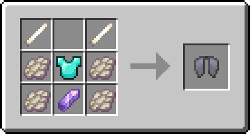                                  |
| Nether Star      | 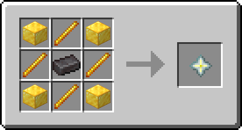                        |
| Trident          | 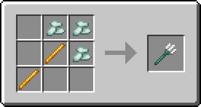                                |
| Bell             | 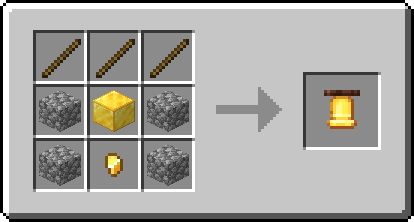                                      |
| Bundle           | 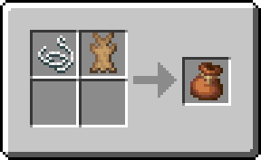                           |
| Shulker Box      | 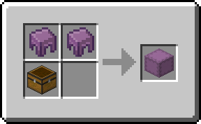                        |
| 2 Shulker Shells | 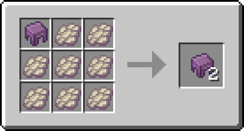                 |
| Sculk Sensor     | 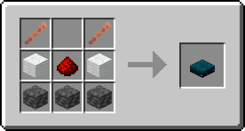Any wool color works. |
| Wither Rose      | 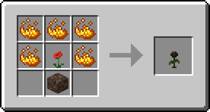Soul sand or soul soil. |

### 🛡️ Armor

| Result                   | Recipe                                                                                                |
| ------------------------ | ----------------------------------------------------------------------------------------------------- |
| Copper Horse Armor       | 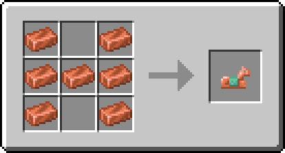                            |
| Iron Horse Armor         | 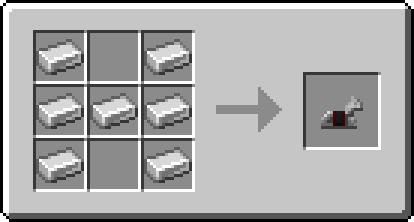                                |
| Golden Horse Armor       | 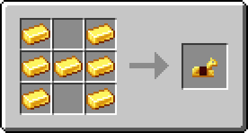                            |
| Diamond Horse Armor      | 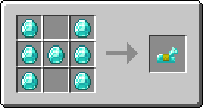                          |
| Copper Nautilus Armor    | 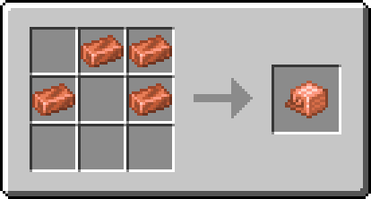                      |
| Iron Nautilus Armor      | 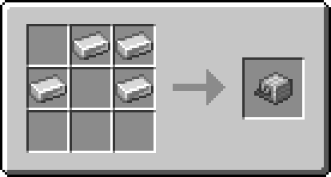                          |
| Golden Nautilus Armor    | 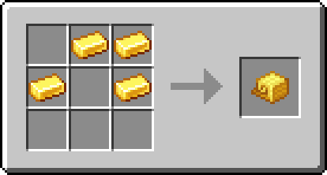                      |
| Diamond Nautilus Armor   | 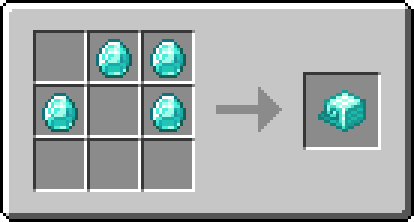                    |
| Netherite Nautilus Armor | 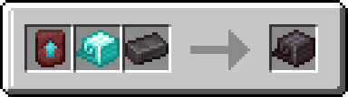Smithing table. |
| Chainmail Helmet         | 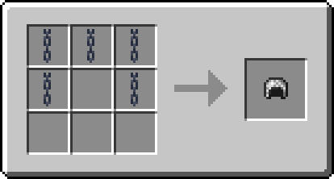                            |
| Chainmail Chestplate     | 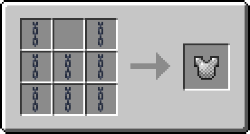                    |
| Chainmail Leggings       | 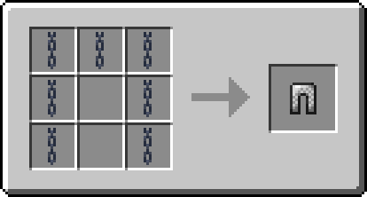                        |
| Chainmail Boots          | 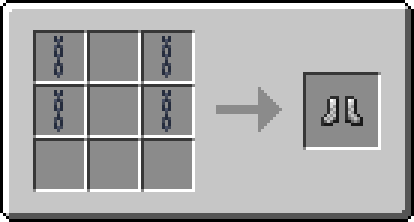                              |

### 🌱 Natural blocks

| Result                 | Recipe                                                                                                    |
| ---------------------- | --------------------------------------------------------------------------------------------------------- |
| 6 Grass Blocks         | 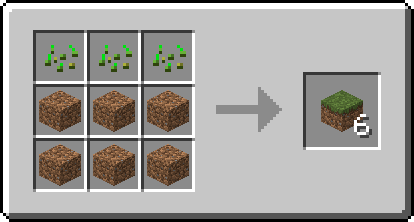Any seeds: wheat, pumpkin, melon or beetroot.     |
| 6 Podzol               | 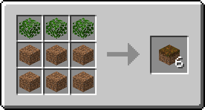Any leaves: oak, spruce, birch, jungle, acacia or dark oak.  |
| 6 Mycelium             | 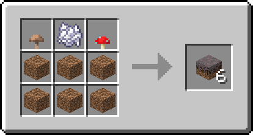                                                |
| Moss Block             | 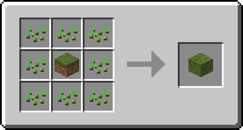Any seeds.                                             |
| Gravel                 | 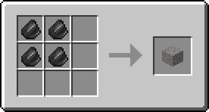                                                               |
| Crimson Nylium         | 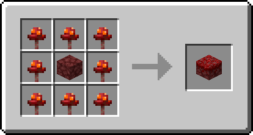                                      |
| Warped Nylium          | 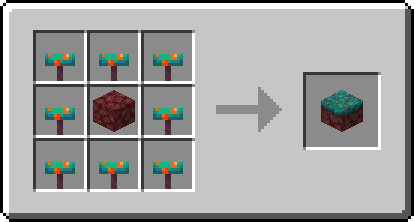                                        |
| Brown Mushroom Block   | 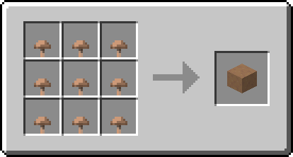                          |
| Red Mushroom Block     | 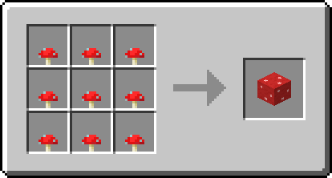                              |
| Tube Coral Block       | 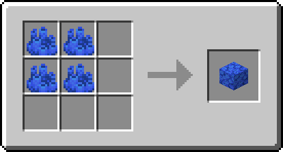Coral or coral fan.                  |
| Brain Coral Block      | 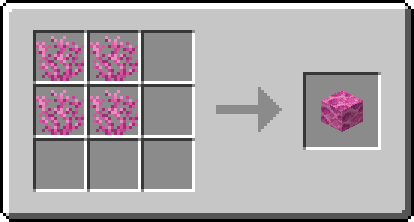Coral or coral fan.                |
| Bubble Coral Block     | 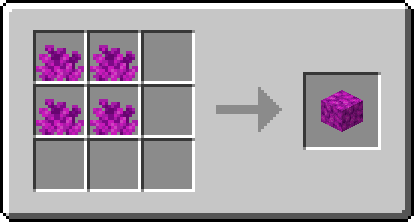Coral or coral fan.              |
| Fire Coral Block       | 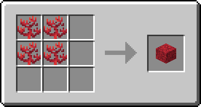Coral or coral fan.                  |
| Horn Coral Block       | 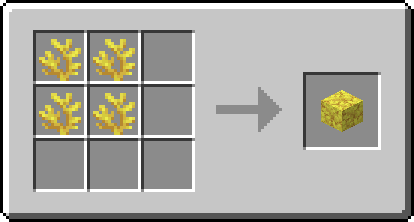Coral or coral fan.                  |
| Soul Sand              | 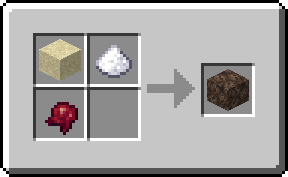                                                    |
| Soul Soil              | 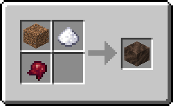Dirt, coarse dirt, grass block, podzol or mycelium. |
| 8 Red Sand             | 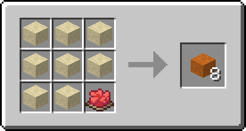                                                |
| 8 Red Sandstone        | 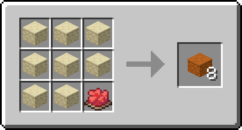                                      |
| 8 Smooth Red Sandstone | 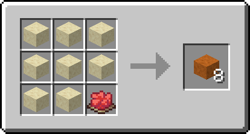                        |
| Slimeball              | 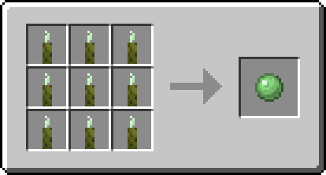                                                        |
| Glow Berries           | 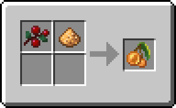                                                   |
| Cobweb                 | 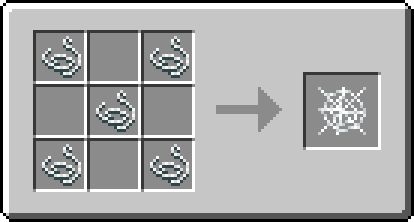                                                               |

### ❄️ Snow and ice

| Result             | Recipe                                                            |
| ------------------ | ----------------------------------------------------------------- |
| 2 Snow Blocks      | 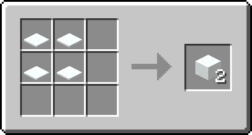       |
| Powder Snow Bucket | 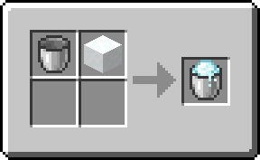 |

Stonecutter:

| Input      | Output                              |
| ---------- | ----------------------------------- |
| Snow Block | 1 ice, 2 snow layers or 4 snowballs |
| Ice        | 1 snow block                        |
| Packed Ice | 9 ice or 9 snow blocks              |
| Blue Ice   | 9 packed ice                        |

### 🧰 Miscellaneous

| Result          | Recipe                                                                                |
| --------------- | ------------------------------------------------------------------------------------- |
| 6 Powered Rails | 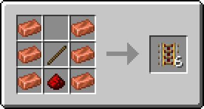                     |
| Bread           | 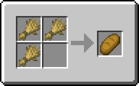                                             |
| 3 Paper         | 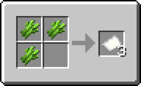                                           |
| Black Dye       | 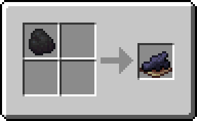Coal or charcoal.                |
| Soul Torch      | Soul sand or soul soil.       |
| Soul Campfire   | Soul sand or soul soil. |

### ♻️ Uncrafting

| Result            | Recipe                                                                     |
| ----------------- | -------------------------------------------------------------------------- |
| 9 Nether Wart     |             |
| 4 Nether Quartz   |                |
| 4 Sand            |                           |
| 4 Red Sand        |                   |
| 4 String          | Any wool color works. |
| 9 Brown Mushrooms |     |
| 9 Red Mushrooms   |         |

### 🔥 Cooking

Actual in-game times with default fuel.

| Input                       | Output          | Furnace | Blast Furnace | Smoker | Campfire |
| --------------------------- | --------------- | ------- | ------------- | ------ | -------- |
| Rotten Flesh                | Leather         | 10 s    |               |        | 20 s     |
| Poisonous Potato            | Potato          | 5 s     |               | 2.5 s  | 10 s     |
| Tropical Fish               | Cooked Cod      | 5 s     |               | 5 s    | 15 s     |
| Brown or Red Mushroom Block | Mushroom Stem   | 10 s    |               |        |          |
| Powder Snow Bucket          | Water Bucket    | 15 s    | 5 s           |        | 30 s     |
| Polished Diorite            | Calcite         |         | 10 s          |        |          |
| Block of Raw Iron           | Block of Iron   |         | 40 s          |        |          |
| Block of Raw Copper         | Block of Copper |         | 40 s          |        |          |
| Block of Raw Gold           | Block of Gold   |         | 40 s          |        |          |

## 📦 Compatibility

|                              |                              |
| ---------------------------- | ---------------------------- |
| **Minecraft versions** | 26.3                         |
| **Type**               | Data Pack (no mods required) |
| **License**            | [CC BY-ND 4.0](LICENSE)       |

## 📥 Installation

Like any data pack: drop the downloaded folder into `.minecraft/saves/<your_world>/datapacks/` (or `<server>/world/datapacks/` on a server), then run `/reload` or restart the world.

## 🖼️ Recipe images

The recipe images are generated from the data pack's JSON files using the textures of your local Minecraft client:

```sh
pip install -r scripts/requirements.txt
python scripts/generate_recipe_images.py --clean
```

The script reads `%APPDATA%/.minecraft/versions/26.3/26.3.jar` by default (launch that version once first), or pass `--jar <path>` / `--mc-version <version>`. `--clean` removes images of deleted recipes.

## 📄 License

Bastion Recipes © 2024 Azerxim, licensed under [CC BY-ND 4.0](https://creativecommons.org/licenses/by-nd/4.0/).
You may share the data pack (including in modpacks or on servers) as long as you credit the author and link to this project. Distributing modified versions is not allowed.
